# CMU Binary Bomb Lab (x86-64) - Complete Write-Up

[Lire la version française](README.fr.md)

## Project Overview
This repository documents the complete walkthrough and reverse engineering of the renowned **Binary Bomb Lab** (originally designed at Carnegie Mellon University), completed as part of the **OST2 (OpenSecurityTraining2)** x86-64 Assembly curriculum.

**Starting Point:** Prior to tackling this challenge, I had no prior experience in software reverse engineering or low-level binary analysis. This project was completed over several days, taking time between phases to thoroughly study assembly concepts and compiler behaviors. The learning curve was steep—particularly on Phases 5 and 6, which heavily involve C pointer arithmetic and dynamic data structures. Through persistence and cross-tool analysis (static decompilation and dynamic debugging), every phase was successfully defused.

**Tooling:**
* **WinDbg:** Dynamic analysis, memory inspection, and runtime control-flow tracing.
* **Ghidra:** Static disassembly and decompiler analysis.
* **Sysinternals Strings:** Initial static reconnaissance.

---

## Phase 1: Static Reconnaissance & String Comparison

### 1. Initial Reconnaissance (Strings)
Before disassembling the binary, an initial static triage was performed using Sysinternals `strings` to extract printable ASCII strings from `bomb.exe`.
Several candidate strings resembled potential passphrases:
* `passphrase`
* `DrEvil`
* `I am just a renegade hockey mom.`

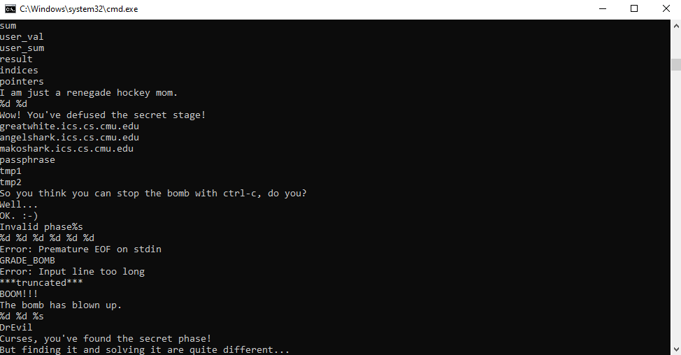

### 2. Dynamic Analysis (WinDbg)
To determine which passphrase was expected, `phase_1` was analyzed dynamically under WinDbg.
Stepping through instructions (`p`), a function argument was prepared immediately prior to calling `strings_not_equal`. The binary loaded a specific memory reference into a register.

Inspecting this address using WinDbg's ASCII string display command (`da [address]`) revealed the exact string expected by the validation routine.

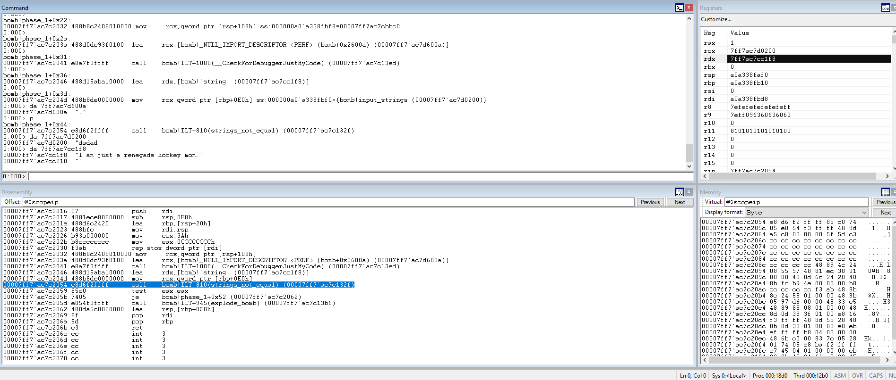

### 3. Solution
The passphrase to defuse Phase 1 is: `I am just a renegade hockey mom.`

---

## Phase 2: Loops & Data Structures (Arrays)

### 1. Static and Dynamic Analysis
Inspecting `read_six_numbers` called at the start of Phase 2 confirmed the use of `sscanf` requiring six integers. By observing consecutive 4-byte stack offsets (`+4`, `+8`, `+0Ch`, etc.) during runtime setup in WinDbg, it became clear that user input was stored into a contiguous integer array (`int[6]`).

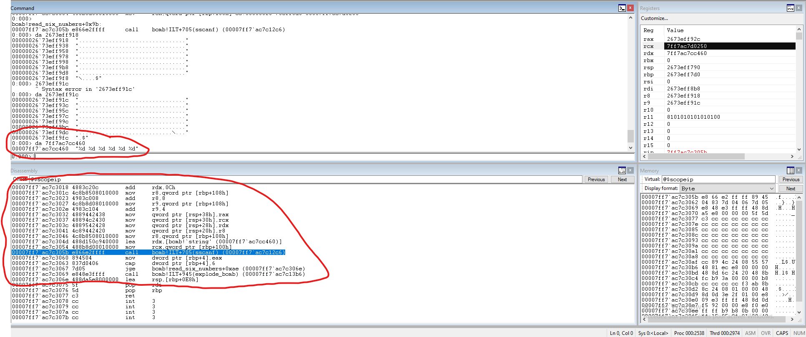

Switching to Ghidra to analyze the validation loop, two constraints were identified:
* The first element must equal `1` (`array[0] == 1`).
* A loop iterates over the remaining five integers enforcing: `array[i] == array[i - 1] * 2`.

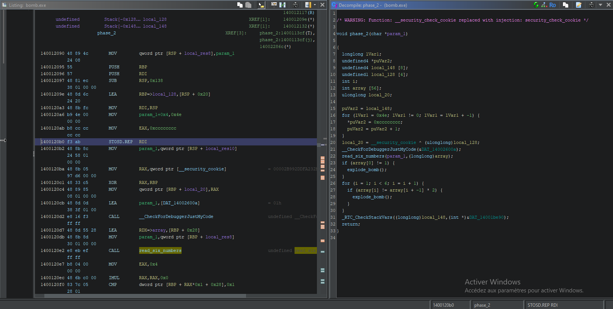

### 2. Solution
Each successive number must be double its predecessor, forming a geometric progression of common ratio 2:
$$2^0, 2^1, 2^2, 2^3, 2^4, 2^5$$

The input to defuse Phase 2 is: `1 2 4 8 16 32`

---

## Phase 3: Control Flow & Fall-Through Switch Statements

### 1. Argument Extraction (WinDbg)
Executing Phase 3 under WinDbg and inspecting the `sscanf` arguments using `da` revealed the format string `%d %d`. The phase requires two integer inputs.

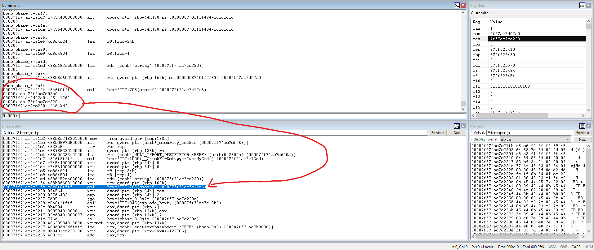

### 2. Algorithm Decompilation (Ghidra)
Ghidra's decompiler revealed a jump table implementing a C `switch` statement governed by the first integer input:
* A post-switch boundary check enforces that the first integer must be $\le 5$ (cases 6 and 7 trigger an explosion).
* Crucially, the `switch` block lacks `break` statements before case 7, exhibiting classic compiler **fall-through** behavior. Execution cascades through every lower case sequentially.

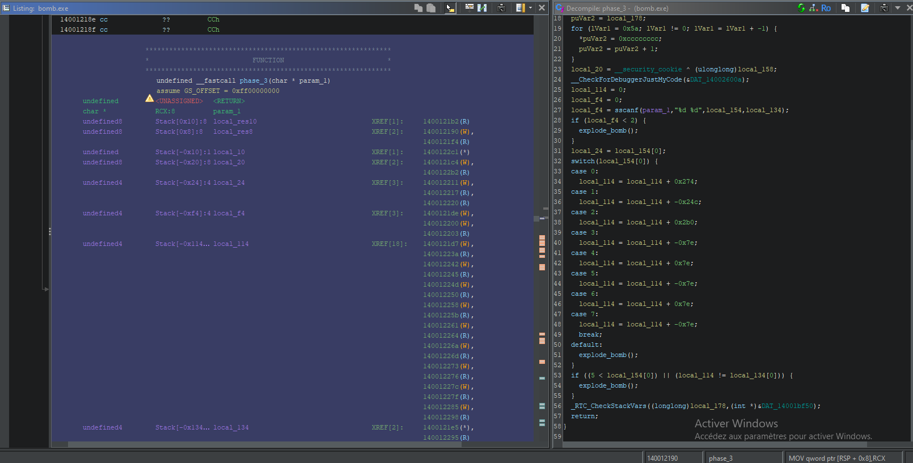

### 3. Resolution
Selecting case `5` as our entry point:
* Case 5 executes: `- 0x7e`
* Cascades into Case 6: `+ 0x7e`
* Cascades into Case 7: `- 0x7e`

The resulting accumulator evaluates to `-0x7e` (`-126` in decimal). The second argument must match this accumulated total.

The input to defuse Phase 3 is: `5 -126`

---

## Phase 4: Recursion & Binary Search Trees

### 1. Static Constraints (`phase_4`)
Inspecting `phase_4` reveals another `sscanf` call expecting two integers (`%d %d`).
Strict range checks are enforced on the first integer:
* It must satisfy $0 \le x \le 14$ (`0xe`).
* Out-of-bounds values trigger `explode_bomb`.

The binary then calls `func4` with three parameters: `func4(first_input, 0, 14)`.
Upon return:
* The return value of `func4` must equal `10` (`0xa`).
* The second user input must also equal `10`.

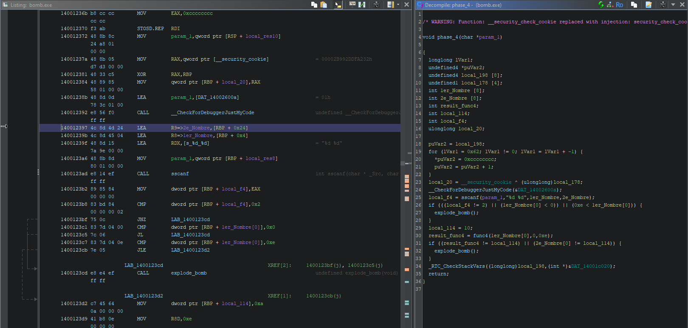

### 2. Recursive Function Analysis (`func4`)
`func4` implements a binary search tree (dichotomy) traversal with value accumulation:
1. **Midpoint computation:** `mid = low + (high - low) / 2`.
2. **Left/Right Branches:** The function recursively traverses the lower or upper half if the input is smaller or larger than `mid`, accumulating `mid` upon unwinding the call stack.
3. **Base Case:** When the input matches `mid`, recursion terminates and returns `mid`.

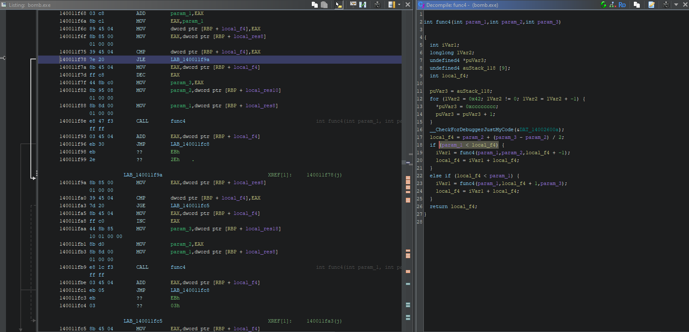

### 3. Mathematical Resolution
To satisfy `func4(X, 0, 14) == 10`:
* **Call 1:** Range `[0, 14]`, calculated midpoint is $0 + (14 - 0) / 2 = 7$. Remaining value needed: $10 - 7 = 3$.
* **Call 2 (Left branch, $X < 7$):** Range `[0, 6]`, calculated midpoint is $0 + (6 - 0) / 2 = 3$.
* If $X = 3$, the base case is reached immediately ($3 == 3$) and returns `3`.
* Unwinding the stack computes $7 + 3 = 10$, satisfying the return condition.

The input to defuse Phase 4 is: `3 10`

---

## Phase 5: Pointer Arithmetic, Static Tables & Directed Graphs

### 1. Static Constraints & Bitmasking
Phase 5 expects two integers. The first argument undergoes bitwise AND masking:
`index = first_input & 0xf;`

This operation isolates the lowest 4 bits, constraining the starting index strictly within `[0, 15]`.

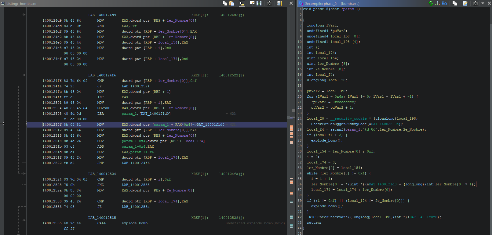

### 2. Memory Dereferencing (`DAT_14001f1d0`)
The decompiler shows an indexed pointer access: `*(uint *)(base + index * 4)`.
Examining memory at `DAT_14001f1d0` reveals a static array of 16 integers:

| Index | 0 | 1 | 2 | 3 | 4 | 5 | 6 | 7 | 8 | 9 | 10 | 11 | 12 | 13 | 14 | 15 |
| :---: | :-: | :-: | :-: | :-: | :-: | :-: | :-: | :-: | :-: | :-: | :-: | :-: | :-: | :-: | :-: | :-: |
| **Value** | 10 | 2 | 14 | 7 | 8 | 12 | 15 | 11 | 0 | 4 | 1 | 13 | 3 | 9 | 6 | -- |

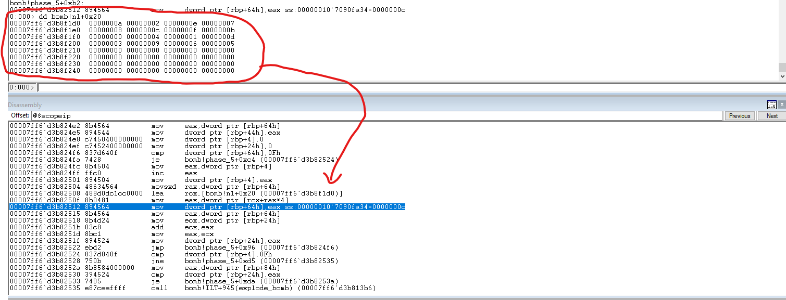

### 3. Graph Traversal Logic
The loop acts as a directed graph / finite-state machine where each visited value serves as the array index for the next jump.
To pass validation:
* The traversal must take **exactly 15 hops** (`i == 0xf`) before landing on target value `15`.
* The second user input must equal the **cumulative sum** of all 15 visited nodes.

### 4. Resolution
Tracing the table backwards identifies a single valid 15-step chain originating at index `5`:
`5 -> 12 -> 3 -> 7 -> 11 -> 13 -> 9 -> 4 -> 8 -> 0 -> 10 -> 1 -> 2 -> 14 -> 6 -> [15]`

Summing all visited values:
$$12 + 3 + 7 + 11 + 13 + 9 + 4 + 8 + 0 + 10 + 1 + 2 + 14 + 6 + 15 = 115$$

The input to defuse Phase 5 is: `5 115`

---

## Phase 6: Linked Lists, Dynamic Memory & Endianness

### 1. Input Constraints
Phase 6 uses `read_six_numbers` to read six integers. Nested verification loops enforce:
* Valid range: $1 \le \text{input}[i] \le 6$.
* Strict uniqueness: duplicate integers trigger an explosion. The input must be a unique permutation of `{1, 2, 3, 4, 5, 6}`.

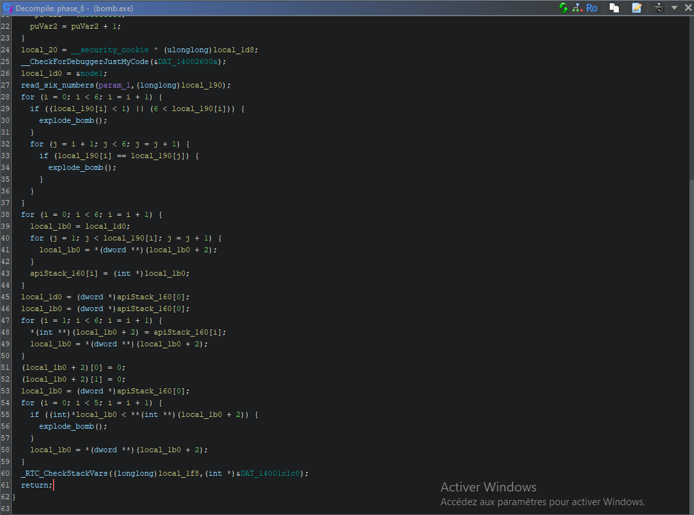

### 2. Identifying Linked List Structures
Decompiled pointer increments of `*(int **)(local_1b0 + 2)` translate to 8-byte offsets in x64 assembly (`MOV RAX, qword ptr [RAX + 0x8]`). This confirms each element is a linked list node:
```c
struct Node {
    int value;         // Offset 0x0 (4 bytes): Node value
    int id;            // Offset 0x4 (4 bytes): Node identifier (1 to 6)
    struct Node *next; // Offset 0x8 (8 bytes): Pointer to next node
};
```
The program rebuilds the list's `next` pointers according to the user-provided permutation. The terminal check requires the newly linked list to be sorted in **strictly descending order** (`current->value >= next->value`).

### 3. Data Extraction & The Little-Endian Trap
Inspecting the node values in static memory requires reading 32-bit integers under x86-64 **Little-Endian** byte ordering:

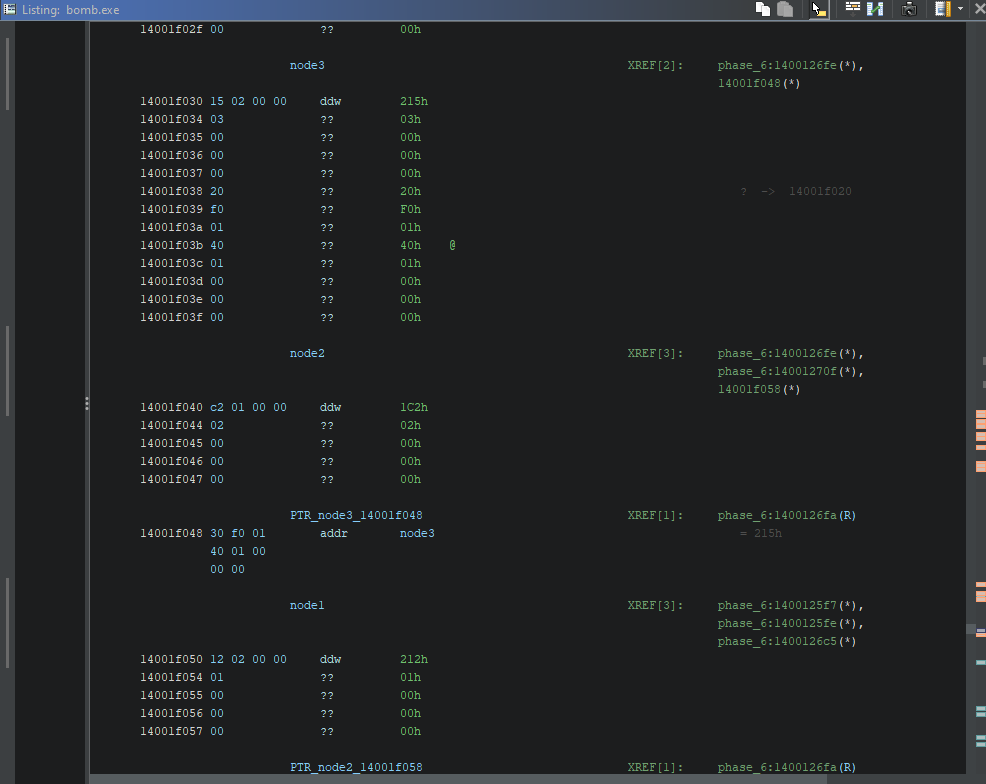
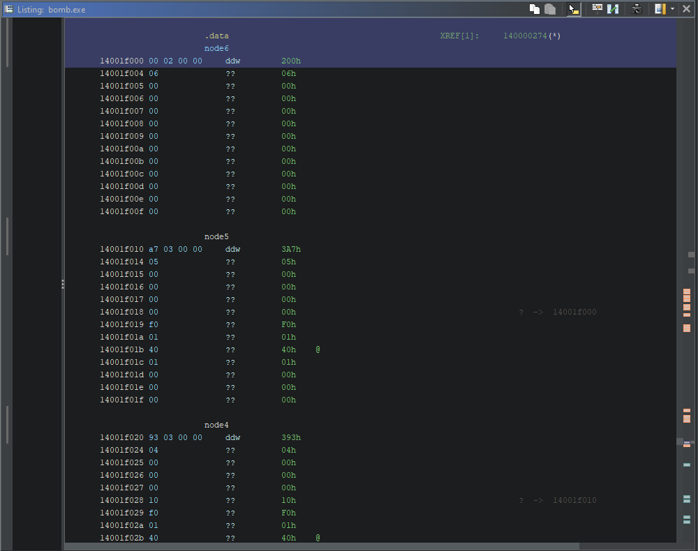

* `node1`: `12 02 00 00` $\rightarrow$ `0x0212` $\rightarrow$ **530**
* `node2`: `c2 01 00 00` $\rightarrow$ `0x01c2` $\rightarrow$ **450**
* `node3`: `15 02 00 00` $\rightarrow$ `0x0215` $\rightarrow$ **533**
* `node4`: `93 03 00 00` $\rightarrow$ `0x0393` $\rightarrow$ **915**
* `node5`: `a7 03 00 00` $\rightarrow$ `0x03a7` $\rightarrow$ **935**
* `node6`: `00 02 00 00` $\rightarrow$ `0x0200` $\rightarrow$ **512**

### 4. Resolution
Sorting the nodes in descending order by numerical value:
$$935 > 915 > 533 > 530 > 512 > 450$$
$$\text{node5} \rightarrow \text{node4} \rightarrow \text{node3} \rightarrow \text{node1} \rightarrow \text{node6} \rightarrow \text{node2}$$

The input to defuse Phase 6 is: `5 4 3 1 6 2`

---

## Summary of Technical Competencies

Completing this challenge consolidated several fundamental reverse engineering capabilities:
* **Static Reconnaissance:** Identifying plaintext artifacts and symbol structures.
* **Low-Level Assembly Analysis:** Dissecting calling conventions, stack frames, register allocation, and memory offsets.
* **Control-Flow Deobfuscation:** Unraveling jump tables, compiler optimizations, and fall-through switch constructs.
* **Algorithmic Reconstruction:** Reverse engineering recursive routines, binary search trees, and finite-state graph traversals without source code.
* **Memory Forensics:** Dissecting heap/data structures, pointers, and accounting for architecture-specific byte ordering (Little-Endian).

### Personal Takeaway

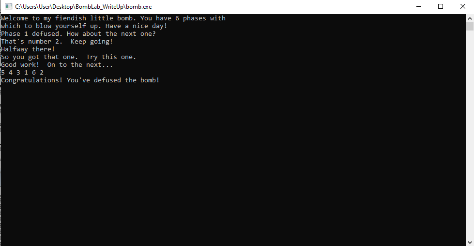

Seeing the final defusal message in the console was an immensely rewarding milestone. Tackling this lab pushed me well beyond my comfort zone. It taught me how to approach complex disassembled code methodically, how to filter compiler noise, and how to effectively leverage industry-standard tools like WinDbg and Ghidra.

Overcoming the roadblocks on recursion and pointer structures transformed initial frustration into genuine confidence. This challenge confirmed my passion for binary analysis and reverse engineering—I look forward to applying these fundamentals to real-world malware analysis and vulnerability research.